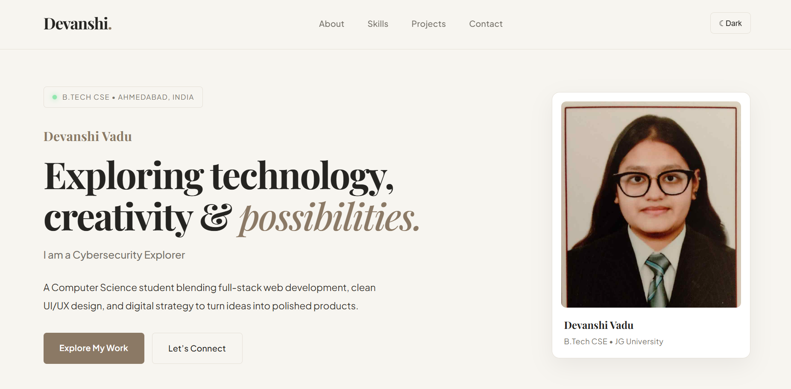

# Devanshi Vadu — Personal Portfolio

A responsive personal portfolio website built for the Web Technology Internal Assessment, showcasing my background, technical toolkit, featured projects, and an interactive contact form.

## Technologies Used
- **HTML5:** Semantic structure (`header`, `nav`, `section`, `footer`) and contact form
- **CSS3:** Editorial typography, light/dark themes, hover effects, and responsive media queries
- **JavaScript:** Theme toggle, mobile navigation menu, typewriter effect, scroll progress bar, and form validation

## Screenshot

